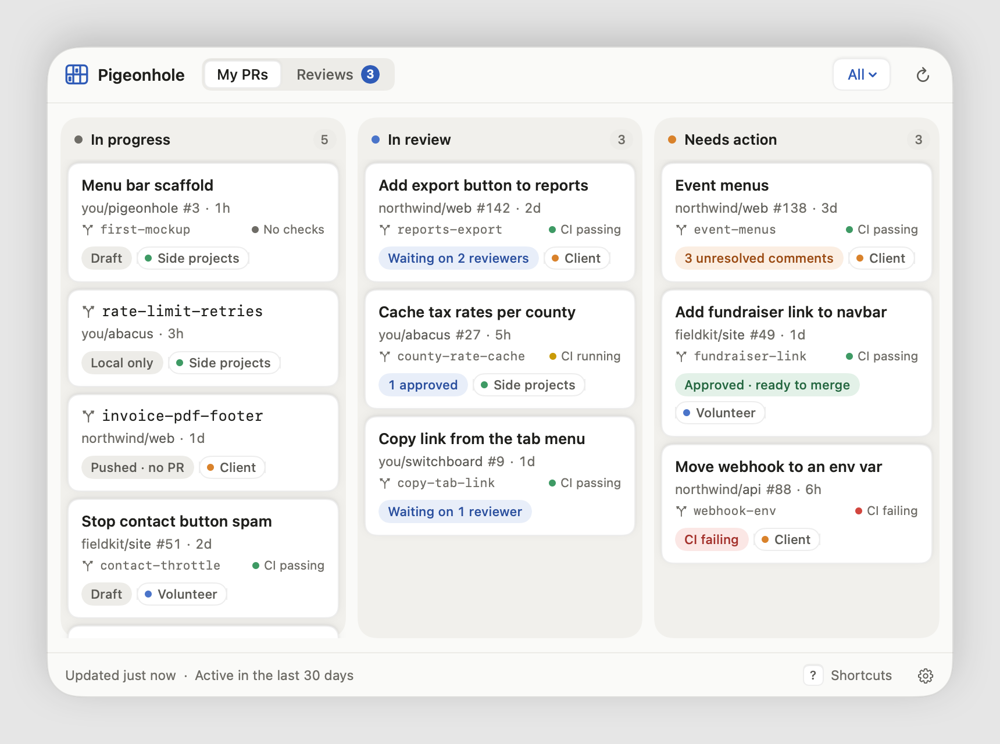
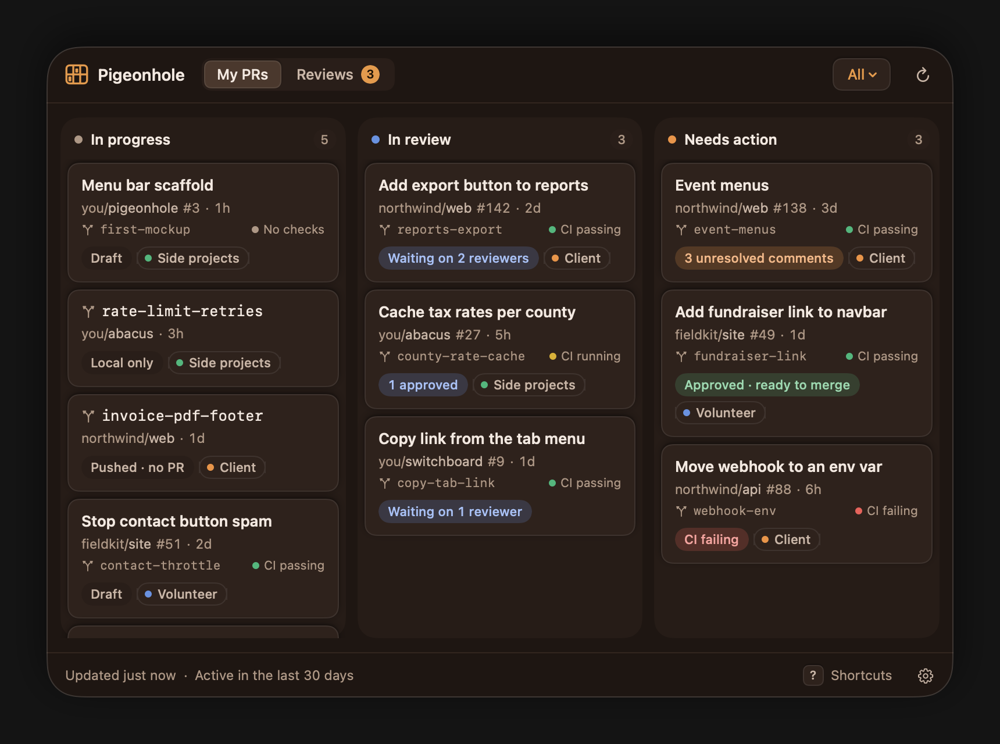
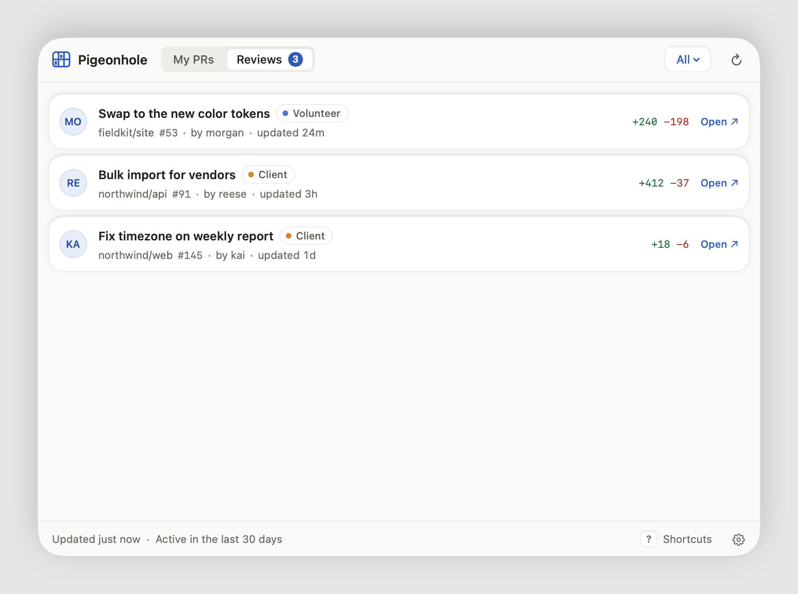
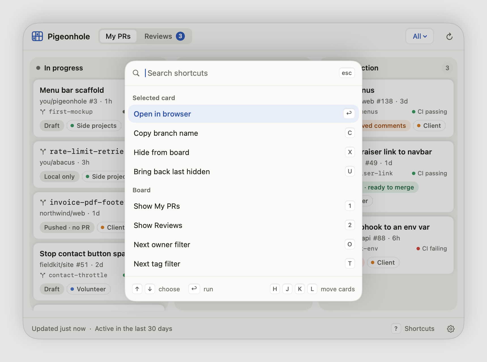
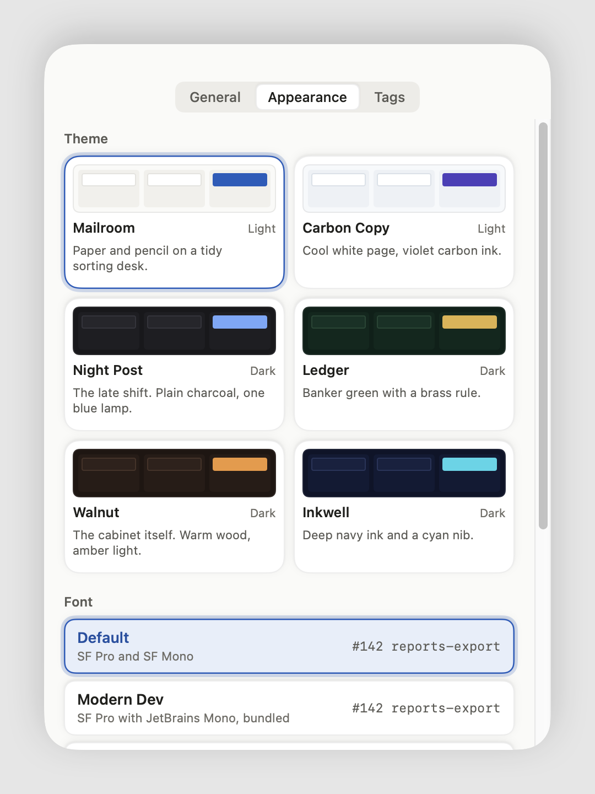
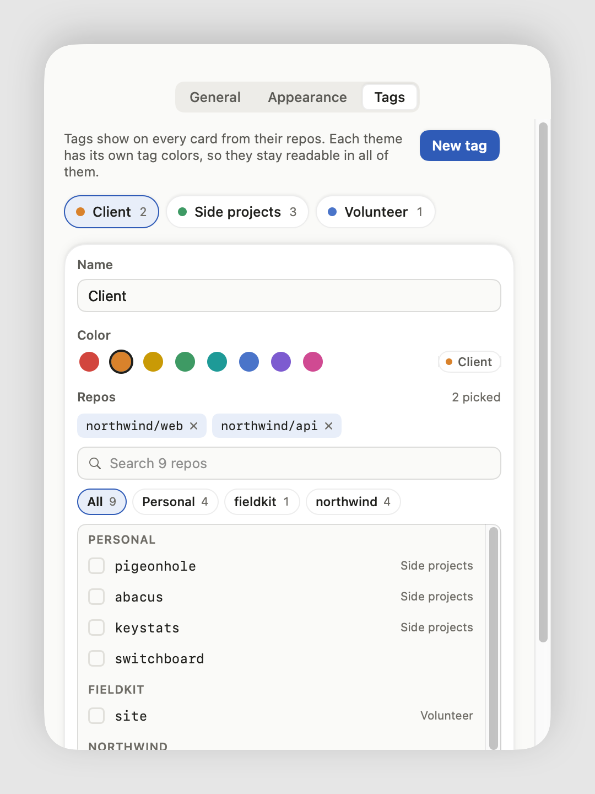

# Pigeonhole

A pigeonhole cabinet is the wall of wooden slots an old mailroom sorted
letters into. Pigeonhole does the same with your GitHub pull requests, from
the menu bar.



## What it does

- **Three slots.** In progress holds your drafts, plus branches in your local
  clones that have no PR yet, pushed or not. In review holds PRs waiting
  on reviewers. Needs action holds anything waiting on you: changes
  requested, unresolved comments, failing CI, or approved and ready to merge.
- **Reviews tab** for PRs where your review was requested.
- **Every org at once.** Filter by owner (All, Personal, or one org) and by
  your own tags.
- **Tags** for repos you care about, with a name and color, shown on every
  card. Filter by a tag or by Untagged. The repo picker lists every repo in
  your account and each of your orgs, searchable and filterable by owner.
- **Click a card** to open the PR in your browser and copy its branch name.
  A pushed branch opens GitHub's compare page, ready for its PR; one that
  isn't pushed yet opens its clone in Finder. **⌥⌘P** (changeable) shows or
  hides the board from anywhere, and hiding it hands focus back to the app
  you were in.
- **Right click a card**, or select it and press X, to hide it. Hidden cards
  are listed in Settings, where you can bring them back, and U brings back
  the last one straight from the board.
- **Keyboard driven.** Arrow keys (or H J K L) move between cards, Return
  opens one, C copies its branch, X hides it and U brings it back. Tab (or 1
  and 2) switches tabs, O and T step through the owner and tag filters, ⌫
  clears them, R refreshes, comma opens Settings and Escape closes.
- **Shortcut palette.** Press **?** for every shortcut in one searchable
  list. Type to filter, then Return runs the one that's lit.
- **Activity window.** By default only PRs with activity in the last 30 days,
  and branches with a commit in that time, show. You can pick 14, 60 or 90 days, a year, or everything.
- Six themes, two light and four dark, plus six font pairs and three text
  sizes.







<p>
  
  
</p>

Branches come from the folders picked in Settings (by default `~/code`,
`~/Developer`, `~/Projects`, `~/src` or `~/dev`, whichever exist, plus any
other folder in your home that holds a clone), searched
three folders deep for clones with a GitHub `origin`. A branch counts as
yours when its newest commit's author matches the repo's `user.email`.
Pigeonhole skips the default branch, branches whose upstream is gone, and
any branch that has had a PR of yours, open, closed or merged. It reads with
`git for-each-ref` and never fetches, so pushes from other machines show up
once your clone has fetched them.

It's read-only. It borrows the GitHub CLI's login, so there's no token to
create, nothing goes in the Keychain, and one login covers every org you've
authorized `gh` for. It only ever talks to `api.github.com`.

## Requirements

- macOS 14 or later
- A Swift toolchain. The Command Line Tools are enough:
  `xcode-select --install`
- The [GitHub CLI](https://cli.github.com), signed in:
  `brew install gh && gh auth login`

## Install

```sh
git clone https://github.com/Silas-N-Schlax/pigeonhole.git
cd pigeonhole
Scripts/create-signing-cert.sh   # optional, once per machine, asks for your password
Scripts/build-app.sh             # builds, installs to /Applications, opens it
```

Look for the cubbies in your menu bar. Left click opens the board; right
click has Refresh, Settings and Quit. To update later, `git pull` and run
`Scripts/build-app.sh` again.

The signing certificate gives every build the same signature, which keeps
"Open at login" pointing at the right app across rebuilds. Without it the
build falls back to ad-hoc signing and still works.

## Missing PRs from an org?

That org probably restricts OAuth apps or uses SAML single sign-on. Run
`gh auth refresh`, or authorize the GitHub CLI for that org on github.com.
The rest of the board keeps working either way.

## Development

```sh
swift build                                       # debug build
swift run PigeonholeChecks                        # logic checks
swift run PigeonholeSnapshots docs/screenshots    # regenerate these screenshots
```

The screenshots are rendered from made-up sample data, never real PRs.
